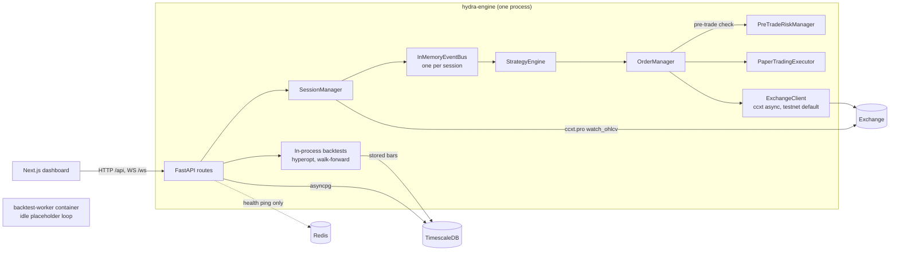

# Hydra

Bitcoin trading platform under active rebuild. What runs today: a FastAPI engine and a Next.js dashboard that run
paper-trading sessions with rule-based strategies on Binance market data, and backtests on bars already stored in
TimescaleDB. Most risk, ML and multi-exchange features are not wired yet; the status table below says which.
**Live trading is not supported until P3.**

## Status

The table describes `main` as it is. Statuses:

- **Working**: proven by the named test or command.
- **Partial**: some of it works; the caveat says what does not.
- **Planned Px**: scheduled for that phase (see [Roadmap](#roadmap)).
- **Known gap: unscheduled**: not true today and not yet assigned to a phase.

Each PR that changes one of these rows updates the row.

| Area | Capability | Status |
|------|------------|--------|
| Exchanges | Binance, Bybit, Kraken, OKX, spot + futures | **Planned P1/P4.** `ExchangeClient` builds any ccxt class by name. Orders always use the futures class while prices come from the spot feed, and symbols carry no market type. P1 adds a Binance-only gate at session start (other exchanges rejected); other exchanges and perps come in P4. |
| Strategies | Visual rule builder + Python strategies | **Partial.** Rules are saved as YAML and evaluated. Stop-loss and take-profit from the builder are dropped (P1 stops). The builder preview runs on the latest stored bars (`test_preview_uses_the_latest_stored_bars`). |
| Strategies | Hot-reload | **Planned P2.** `StrategyEngine.reload_strategy` exists, but nothing in the app calls it; a session reads its YAML once. |
| Strategies | Built-in strategy classes and shipped configs | **Partial.** Modules in `strategy/builtin/`: breakout, composite, dca, grid, mean_reversion, ml_ensemble, momentum, rule_based, trend_following. DCA and Grid do not work in a session: a DCA deal stalls after its base order and a grid places a one-shot ladder (their order tracking needs the P1 OMS wiring). Shipped strategy configs all use the rule-based class; only templates use DCA and Grid. No test-generated configs are committed (`test_no_committed_test_strategy_yaml`). |
| Backtest | Runs only on stored bars, records provenance, 422 when there is no data | **Working.** `tests/integration/test_backtest_real_data.py::test_backtest_runs_on_stored_bars_with_exact_provenance`, `::test_no_stored_bars_is_422_with_available_range`, `tests/unit/test_dashboard/test_backtest_routes.py`. |
| Backtest | Results and trades persisted, identical after a restart | **Working.** `tests/integration/test_backtest_real_data.py::test_results_survive_a_restart`. Needs TimescaleDB (see [Testing](#testing)). |
| Backtest | Walk-forward / CPCV, PBO, DSR | **Planned P2.** Walk-forward does not re-optimise per fold, CPCV is not reachable from the API, PBO is not CSCV, and DSR is the mean Sharpe. |
| Backtest | VectorBT parameter sweeps | **Planned P2.** `vectorbt` is a dependency but is never imported; the sweep is a numpy SMA cross that ignores fees. |
| Backtest | Realistic fill simulation | **Planned P2.** No partial fills, funding or liquidation; slippage is uncapped. |
| Backtest | Durable job queue | **Planned P2.** Backtests, hyperopt and walk-forward run as in-process tasks in the engine; task state is lost on restart. The `backtest-worker` image runs an idle placeholder loop. |
| ML | XGBoost training | **Planned P5.** Training code has no data loader or entrypoint. There is no LSTM code; the "LSTM Momentum" placeholder was removed in P0-B. |
| ML | ONNX inference, model upload / promote / rollback | **Planned P5.** Inference works in isolation, but no strategy calls it, nothing reads the model stage, and rollback leaves no model in Production. |
| ML | Drift detection | **Planned P5.** A PSI function exists and nothing runs it. The API and UI report drift as `unknown` and retrain returns 501 (P0-C). |
| ML | ML overlay per strategy | **Planned P5.** `MLOverlayConfig` is parsed and never read. |
| Risk | 4-tier circuit breakers | **Planned P1.** `CircuitBreakerManager` is never instantiated. The API returns `circuit_breakers: null` / 503 and the UI shows UNAVAILABLE instead of a hardcoded list (`tests/unit/test_dashboard/test_risk_truth.py`). |
| Risk | Pre-trade checks | **Partial → P1.** The checks exist, but market orders bypass the size checks and some order paths skip them. |
| Risk | Per-strategy risk overrides | **Planned P1.** Override rows are written, but only `scope = 'global'` is read. |
| Risk | Exchange-side stop-losses | **Planned P3.** `ExchangeSafetyManager` has no caller, and paper stops never trigger. |
| Risk | Quick-trade TP / SL / trailing stop | **Planned P1 (stops).** An entry that is not filled at once (any LIMIT quick-trade) returns 200 with `exit_orders_deferred: true`, and its TP / SL / trailing orders are never placed: nothing reads the flag, and the UI shows a success toast. On a filled entry, a failed attach logs a warning and still returns 200. Either way the position looks protected when it is not. |
| Risk | Kill switch | **Partial → P1.** It stops running sessions, and the UI shows active / inactive / unknown. The flag is persisted only when the engine has a DB pool (not the case under `deploy/compose.yml`), yet `POST /api/trading/kill-switch` reports "all trading halted" either way, so a restart forgets it. The flatten step fails and positions stay open. |
| Paper trading | Per-strategy capital, P&L | **Partial → P1.** Per-strategy paper capital slices work. Unrealized P&L is never updated, P&L is gross of fees, and live P&L is 0. |
| Paper trading | Testnet + paper by default | **Partial → P1.** The trading mode defaults to `paper`, and session `ExchangeClient`s default to `testnet=True`. `HYDRA_TESTNET`, `trading.testnet` and `config/live.yaml` are never read. The settings page's balance / orders / positions endpoints use stored keys against mainnet (`testnet=False`), read-only. |
| Data | Redis Streams event bus | **Planned P1** (event-bus isolation decides the transport). Sessions use an in-process `InMemoryEventBus`; `RedisEventBus` is used only in tests. Redis is only health-pinged by `/api/system/health`. |
| Data | PostgreSQL as source of truth | **Partial → P1.** Backtest results and trades are persisted (P0-B). Live fills are not stored, paper state is not reloaded, and system config lives in memory. |
| Data | Decimal for financial values | **Known gap: unscheduled.** Decimal in domain types and fills; floats at the exchange boundary, in routes, VaR and the flatten path. |
| Dashboard | Next.js app, routes listed under [Dashboard routes](#dashboard-routes) | **Working.** `cd dashboard && npm run build` (CI job "Dashboard Build") prints the route list. |
| Dashboard | Risk and portfolio data report unavailable / unknown instead of made-up values | **Working.** `tests/unit/test_dashboard/test_risk_truth.py`, `tests/unit/test_dashboard/test_portfolio_routes.py`, `cd dashboard && npm test`. |
| Dashboard | Every page shows an error instead of defaults | **Known gap: unscheduled.** `/templates` swallows a failed fetch and shows "No templates available yet". `/` and `/portfolio` fall back to `trading_mode: 'paper'` when `/api/system/config` fails and show paper numbers with no error. `/portfolio` drops a failed strategy-list fetch silently. `/api/models` serves `version: v1.0.0` and `stage: Staging` for an `.onnx` without sidecar metadata. |
| Dashboard | Real-time WebSocket updates | **Known gap: unscheduled.** The engine serves `/ws/market`, `/ws/trades`, `/ws/portfolio`, `/ws/signals` and `/ws/risk`; only per-session trade fills are ever broadcast. The session page re-fetches its detail on a fill (P0-C), which fixed the NaN P&L. |
| Dashboard | TradingView charts | **Known gap: unscheduled.** A third-party TradingView embed on `/trading` only; every other chart is Recharts. |
| Monitoring | Prometheus alert rules | **Working (rule logic) → P1 producers.** `promtool test rules deploy/prometheus-rules.test.yml` (workflow "Prometheus Rules") has a firing and a non-firing case for every alert, and `tests/unit/test_deploy/test_prometheus_rules.py` checks that every rule reads a series defined in the metric contract (`src/hydra/core/metrics.py`). Exchange API latency and errors are recorded for every call and outcome (`tests/unit/test_execution/test_exchange_client_metrics.py`). Feed staleness compares timestamp gauges against Prometheus `time()`, but nothing sets those gauges until the P1 feed work. Drawdown (`hydra_drawdown_ratio`) only moves on fills inside a running session until P1 risk wiring. The reconciliation alert was removed: there is no reconciliation until P3. |
| Monitoring | Grafana dashboards (drawdown, P&L, heat, exchange errors) | **Partial → P1 ops.** Every panel reads only exported series with their real labels (`tests/unit/test_deploy/test_grafana_dashboards.py`). Rolling Sharpe, Model Accuracy and Drift PSI were removed because nothing produces them (Sharpe needs a daily-return series; ML is P5). Portfolio Heat, drawdown and P&L stay empty or flat until P1 risk wiring sets them; Win Rate counts every fill with PnL <= 0 as a loss, opening fills (PnL 0) included, and "Strategy Latency" plots order fill latency. |
| Monitoring | Telegram alerts | **Partial.** Paging goes through romulus Alertmanager to Telegram. The in-app bot was deleted in P0-D. |
| Engineering | mypy strict | **Partial → P1 ops.** CI runs `mypy --strict` over eight packages, and `pyproject.toml` relaxes strict mode for most packages through overrides. |
| Engineering | import-linter module boundaries | **Working.** `make imports` (`uv run lint-imports`) prints `Contracts: 1 kept, 0 broken.`; it runs in `make check` and in the CI "Lint & Format" job. Layers: dashboard > portfolio, backtest > execution > risk, ml > strategy > data > indicators > core, ops. |
| Engineering | CI runs unit / integration / e2e | **Partial → P1 ops.** Unit, lint, type, security and dashboard jobs are real. Integration runs against TimescaleDB and Redis containers: the backtest DB tests run there, but the Redis tests always skip because they probe `localhost:6379`. E2E uses no infrastructure. The image build is not gated on CI. |
| Engineering | Every module has tests | **Known gap: unscheduled.** No tests for `backtest/vectorbt_research.py`, `data/ingestion.py` or `ops/notifications.py`. `backtest/hyperopt.py` has no unit tests of its own; it is covered through the route tests and `tests/integration/test_backtest_real_data.py::test_hyperopt_grid_runs_on_stored_bars_reproducibly`. |
| Engineering | Dockerfile references in Makefile, compose files and build workflow | **Working.** `tests/unit/test_repo/test_build_references.py`. |
| Engineering | One version (pyproject) reported everywhere | **Partial.** The engine package, OpenAPI and `PlatformConfig` report the pyproject version (`tests/unit/test_repo/test_version_single_source.py`). The dashboard sidebar still shows `dashboard/package.json`'s version (1.2.0); fixing it needs a build arg in `docker/dashboard/Dockerfile` (Known gap: unscheduled). |

## Architecture (as is)



- The engine is one process: FastAPI, the session manager and every session's event bus. Redis is not on the trading path.
- The schema is created by inline DDL in `src/hydra/dashboard/api.py` at startup. The alembic files under
  `data/migrations` and `portfolio/migrations` and the SQLAlchemy models in `portfolio/models.py` are not used at runtime.
- Backtests load bars through `hydra.backtest.data` from `ts.ohlcv_1m`; nothing is fetched or synthesised on the fly.

## Planned architecture

- **P3** splits the engine into `hydra-trader` (sessions) and `hydra-api` (REST, WebSocket, MCP).
- **MCP v1** (after P2) is served by hydra over streamable HTTP with a bearer token, on its own romulus Traefik router.
  Research and paper tools are fully available; live start, kill-switch release and live orders need a one-time code
  the user types.

## Dashboard routes

| Route | What it does today |
|-------|--------------------|
| `/` | Portfolio summary, equity and daily P&L, open positions. Shows UNAVAILABLE when the DB is down. |
| `/trading` | TradingView embed, Binance order book (REST polling, marked STALE when old), running sessions, quick trade, tri-state kill switch. |
| `/trading/[sessionId]` | Session detail: capital, P&L, positions, trades. Re-fetches on a WebSocket fill. |
| `/strategies` | Strategy list from YAML, start/stop sessions, per-strategy capital and risk overrides (overrides are not enforced yet). |
| `/builder` | Visual rule builder; preview on stored bars. Stop-loss / take-profit are not enforced. |
| `/templates` | Import a strategy from `config/templates/`. |
| `/backtest` | Run a backtest on stored bars, with a provenance panel. |
| `/backtest/[id]` | Result detail: metrics, equity curve, trades. |
| `/backtest/compare` | Compare two results, with a warning when their data differs. |
| `/optimize` | Launch hyperopt / walk-forward as an in-process task. |
| `/optimize/[taskId]` | Task progress and result. |
| `/portfolio` | Positions, allocation, balance snapshots. |
| `/risk` | Risk limits form, drawdown and daily-loss gauges, VaR; circuit breakers show UNAVAILABLE. |
| `/models` | ONNX model registry: upload, promote, rollback. Drift shows Unknown. |
| `/settings` | System config, exchange credentials and webhook secrets (write-only), notifications. |

## Project structure

```
src/hydra/
├── core/         # Config (pydantic + layered YAML), domain types, events, InMemory/Redis event bus, WS manager, Prometheus metric contract (metrics.py)
├── data/         # Ingestion (ccxt.pro), bar storage, backfill, news/sentiment; migrations/ is unused alembic
├── indicators/   # TA-Lib wrappers + custom indicators
├── strategy/     # Strategy base, engine, rule engine, YAML config; builtin/ holds the built-in classes
├── backtest/     # Runner, bar loader, fills, metrics, hyperopt, walk-forward, vectorbt_research
├── execution/    # SessionManager, OrderManager, paper executor, ccxt ExchangeClient
├── risk/         # Pre-trade checks, sizing, circuit breakers and exchange safety (not wired)
├── portfolio/    # P&L, positions, reconciliation; models.py + migrations/ are unused SQLAlchemy/alembic
├── ml/           # Features, ONNX serving/export, registry, drift, training (not wired, P5)
├── dashboard/    # FastAPI app (api.py), routes/
└── ops/          # Discord / Slack webhook notifier
dashboard/        # Next.js app (see dashboard/README.md)
docker/           # engine/, dashboard/, backtest/, ml/ — one Dockerfile each
deploy/           # Local full-stack compose, Prometheus rules + promtool tests, Grafana dashboard
config/           # base/live/backtest YAML, strategies/, templates/, grafana/
scripts/          # download_history.py, seed_db.py, sync_models.py
tests/            # unit/, integration/, e2e/, performance/
```

## Tech stack

- Python: images run 3.14 (`python:3.14-slim`); `requires-python = ">=3.12"`, ruff and mypy target 3.12; the ML image
  uses 3.12. CI does not pin an interpreter. A single pin is a P1 ops item.
- FastAPI + uvicorn, raw asyncpg (no ORM at runtime), pydantic / pydantic-settings, structlog.
- ccxt async for REST and ccxt.pro for the session market-data feed.
- TimescaleDB on PostgreSQL 16, Redis.
- Next.js 16.4, React 19, TypeScript 7 (`tsc --noEmit`; lint and `next build` use the TypeScript 6 API package),
  Tailwind CSS 4, Recharts, vitest + jsdom.
- ML libraries (onnxruntime; xgboost, torch, mlflow etc. in the `ml-training` extra) are installed in the images but
  not wired into trading (P5).
- Prometheus rules and Grafana dashboards live here; the running Prometheus, Alertmanager and Grafana are in romulus.

## Quick start

Requires [uv](https://docs.astral.sh/uv/). CI installs with:

```bash
uv sync --locked --extra dev
uv run pytest tests/unit -m "not slow"
```

`make dev` installs every extra, including `ml-training` (torch, xgboost, mlflow), which is large. `make install`
installs runtime dependencies only, without the test tools.

To run the engine against a local database, start TimescaleDB and Redis with `make dev-up` (needs Docker), then set
`DATABASE_URL` (and `REDIS_URL`) and run `uv run python -m hydra.dashboard.api`. `.env.example` predates the current
config: several of its keys (`HYDRA_DB_*` for the API, `HYDRA_PAPER_TRADING`, `HYDRA_CORS_ORIGINS`) are not read the
way it implies; P1 config rewrites it.

## Development

```bash
make lint          # ruff check + ruff format --check on src/ and tests/
make format        # ruff --fix + ruff format
make type-check    # mypy src/ (pyproject config; CI also runs the --strict command in ci.yml)
make security      # bandit
make test          # unit tests, not slow, with coverage
make unit          # all unit tests, verbose
make integration   # integration tests; DB tests skip unless HYDRA_DB_HOST is set
make e2e           # e2e tests (no infrastructure needed)
make perf          # benchmarks, writes benchmark.json
make imports       # import-linter layers contract
make check         # lint + type-check + security + imports + test
make dev-up        # TimescaleDB + Redis via docker-compose.dev.yml (needs Docker)
make dev-down      # stop them
make docker-build  # build hydra-engine, hydra-dashboard, hydra-backtest (needs Docker)
make clean         # remove caches and build output
```

Other compose files:

- `deploy/compose.yml` is a local full-stack approximation, not the deployment. Its env names do not match what the
  engine reads, so the engine starts without a DB pool, and the dashboard's `/api` rewrite does not reach the engine.
  Both wait for P1 config.
- `docker-compose.ml.yml` is non-functional until P5 (see its header).

## Testing

| Suite | Needs | Command |
|-------|-------|---------|
| Unit | nothing | `uv run pytest tests/unit -m "not slow"` |
| Integration | TimescaleDB (`HYDRA_DB_HOST`, `HYDRA_DB_PORT`, `HYDRA_DB_NAME`, `HYDRA_DB_USER`, `HYDRA_DB_PASSWORD`); Redis on `localhost:6379` | `uv run pytest tests/integration -m integration` |
| E2E | nothing (in-memory) | `uv run pytest tests/e2e -m e2e` |
| Performance | nothing | `uv run pytest tests/performance -m performance` |
| Dashboard | Node 26 | `cd dashboard && npm ci && npm test` |

The DB integration tests create and drop their own database. They skip when `HYDRA_DB_HOST` is unset and fail when it
is set but the server is unreachable. For the current number of tests, run `uv run pytest --collect-only -q`.

What CI runs (`.github/workflows/ci.yml`): lint, `mypy --strict` over core, data, indicators, strategy, backtest,
execution, risk and portfolio, bandit, unit tests with a clean-tree check, the dashboard (lint, typecheck, test,
build), integration and e2e. `rules.yml` runs promtool on the Prometheus rules. Performance tests are not run in CI.

## CI/CD and releases

- Every PR to `main` runs CI and the promtool workflow.
- A push to `main` that touches `src/`, `docker/`, `dashboard/`, `pyproject.toml` or `uv.lock` runs `build.yml`. It
  builds `hydra-engine`, `hydra-dashboard` and `hydra-backtest` and pushes `main` and `sha-<7>` tags to GHCR. The
  version tag from `pyproject.toml` is pushed only if it does not exist yet, so version tags never move: releasing
  means bumping the version. The build does not wait for CI (P1 ops gates it).
- Releases happen at the end of a phase: `pyproject.toml` version, `uv lock`, and the romulus image tags move together.
- Dependabot PRs in this repo auto-merge on green CI for minor/patch updates (`dependabot-auto-merge.yml`); majors,
  0.x minors, pre-releases and base images wait for review.

## Deployment

Production is the `hydra` stack in [romulus](https://github.com/somatczk/romulus) (`stacks/hydra/`), a Docker Compose
stack on a ZimaCube running Ubuntu 26.04, applied by doco-cd. Each service there is a one-line Dockerfile
(`FROM ghcr.io/somatczk/hydra-<image>:<version>`); Dependabot in romulus opens the bump PRs. Romulus P0-E2 (in
progress) holds hydra bumps back from auto-merge, removes the public `/health` + `/metrics` router and drops the
remaining Telegram env.

## Roadmap

- **P0 Truth**: docs, UI and API stop claiming what is not true; backtests use real stored bars. (This phase.)
- **P1 Safe paper trading**: config/creds/lifespan, feed, event-bus isolation, risk and circuit-breaker wiring, paper
  executor, stops and OMS, Binance gate, API security, ops (CI on real PG/Redis, import-linter, python pin).
- **P2 Trustworthy backtester**: shared execution core, realistic fills, real WFO / CSCV PBO / DSR, durable job queue,
  real vectorbt, hot-reload.
- **MCP v1** (after P2): service layer exposed as MCP tools; live tools gated by a one-time code.
- **P3 Live spot (Binance)**: order state machine, reconciliation, exchange stops, live gating, trader/api split.
- **P4 Perps.**
- **P5 ML.**

## License

Proprietary. See [LICENSE](LICENSE).
